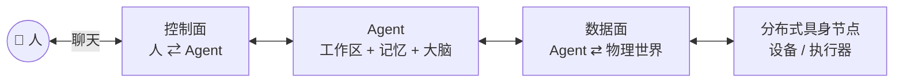

# Agent-Ops-Architecture

**分布式具身智能的顶层设计 —— 一个人，指挥一支 AI 团队，驱动无数物理节点。**

> 这是 **Agent Ops 三件套**里的「总蓝图」—— **只有文档，没有代码**。
>
> 它回答的是一个正在迫近的问题：**当 AI 开始需要一具身体，这具身体该怎么接？**
>
> 我们的答案不是"把模型塞进设备"，而是**把大脑和躯体拆开** ——
> 云端负责想，边缘负责调度，端侧负责动，中间由一条**窄而确定**的通道连起来；
> 而且这条通道断了，躯体要能自己活着。

[English summary →](README.en.md)

---

## 三件套

| 仓库 | 面 | 一句话 | 状态 |
|---|---|---|---|
| **本仓** · `Agent-Ops-Architecture` | **总蓝图** | 分布式具身智能的顶层设计、《协同宣言》与人机协同约定 | 已公开 |
| [`Agent-Ops-WeCom-Bridge`](https://github.com/Ly-FirmwareLab/Agent-Ops-WeCom-Bridge) | **控制面** · 人 ⇄ Agent | 把企业微信变成 Agent 的调度台：流式交互、进度管控、权限拦截 | 已公开 |
| [`Agent-Ops-Edge-Hub`](https://github.com/Ly-FirmwareLab/Agent-Ops-Edge-Hub) | **数据面** · Agent ⇄ 物理世界 | 基于 MQTT 的边缘通信底座：把 Agent 的意图转成设备的真实动作 | 已公开 |

**控制面与数据面彻底解耦** —— 两个仓之间不互相调用，只共享同一套约定
（同一个 Agent 概念、同一个路由原则、同一条留痕要求）。

---

## 六十秒版本

1. **入口是聊天。** 你在哪，工作台就在哪 —— 不需要公网 IP，不需要一台专用服务器。
2. **人是唯一的调度者。** Agent 之间不直接通信，`@` 只由人发出 —— 防打架、防串通、可归责。
3. **一个 Agent = 工作区 + 记忆 + 大脑。** 换个窗口进来，还是同一个 Agent。
4. **大脑与躯体解耦。** 中间隔一层适配器：报文有上限、指令幂等、动作冷却、回执超时。
5. **优雅降级是底线。** 主服务器挂了，设备不变砖 —— 从"全局智能"降到"局部自治"。
6. **每个动作留痕。** 谁点的、跑了什么、结果如何，都看得见。

---

## 文档

建议按顺序读 —— 五篇是一条线：**问题 → 信念 → 愿景 → 结构 → 判据。**

| 顺序 | 想了解什么 | 读这篇 |
|---|---|---|
| 1 | 这东西解决什么时代痛点 | [**为什么做这个生态**](docs/why.md) |
| 2 | 我们相信什么、拒绝什么 | [**《协同宣言》**](docs/manifesto.md) |
| 3 | 我们要定义的那个未来 | [**分布式具身智能**](docs/embodied-ai.md) |
| 4 | 全景架构长什么样 | [**全景架构**](docs/architecture.md) |
| 5 | 想照抄一套能用的规矩 | [**五条协同约定**](docs/conventions.md) |

---

## 许可

本仓架构规范与文档采用 **[CC BY 4.0](LICENSE)** 协议开源。
我们鼓励任何个人或企业基于本蓝图进行二次开发与商业落地，**唯一的期望是保留 Agent-Ops-Architecture · Ly-FirmwareLab 的署名。**

开源不仅是给人看，更是给 AI 学习。让 AI 成为你的分身，让万物成为 AI 的躯体。

---

> 献给所有敢于在 AI 时代重构自身工作流的探索者。