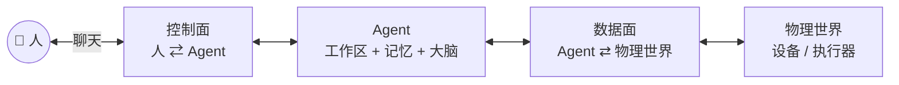

# Agent-Ops-Architecture

**一个人，如何指挥一支 AI 团队**

> 这是 **Agent Ops 三件套**里的「总蓝图」—— **只有文档，没有代码**。
> 它回答的不是"怎么装"，而是"**为什么这样设计**"。

[English summary →](README.en.md)

---

## 三件套

| 仓库 | 角色 | 一句话 |
|---|---|---|
| [`Agent-Ops-WeCom-Bridge`](https://github.com/Ly-FirmwareLab/Agent-Ops-WeCom-Bridge) | **控制面** · 人 ⇄ Agent | 让企业微信成为 Agent 的指挥台：进度可见、随时可停、危险动作先拦下 |
| [`Agent-Ops-Edge-Hub`](https://github.com/Ly-FirmwareLab/Agent-Ops-Edge-Hub) | **数据面** · Agent ⇄ 物理世界 | MQTT 设备总线与端侧接入：让 Agent 的指令真正落到硬件上 |
| **本仓** · `Agent-Ops-Architecture` | **总蓝图** · 为什么这样搭 | 《协同宣言》、全景架构，以及把两者串起来的那套人机协同约定 |

它们不是三个功能，而是**同一套架构的三个切面**：

---

## 30 秒版本

1. **入口是聊天。** 你在哪，工作台就在哪 —— 不需要公网 IP，不需要一台专用服务器。
2. **人是唯一的调度者。** Agent 之间不直接通信，`@` 只由人发出。
3. **一个 Agent = 工作区 + 记忆 + 大脑。** 换个窗口进来，还是同一个 Agent。
4. **能力分层。** 官方已经有的一律用官方，官方没覆盖的才自己补。
5. **每个动作留痕。** 谁点的、跑了什么、结果如何，都看得见。

---

## 文档

| 想了解什么 | 读这篇 |
|---|---|
| 这东西解决什么时代痛点 | [**为什么做这个生态**](docs/why.md) |
| 我们相信什么、拒绝什么 | [**《协同宣言》**](docs/manifesto.md) |
| 全景架构长什么样 | [**全景架构**](docs/architecture.md) |
| 想照抄一套能用的规矩 | [**五条协同约定**](docs/conventions.md) |

建议按顺序读 —— 四篇是一条线：**为什么做 → 相信什么 → 怎么搭 → 怎么验。**

---

## 许可

本仓文档采用 **[CC BY 4.0](LICENSE)** 许可 —— 可以转载、引用、改编，**只要署名**。

署名请写：**Agent-Ops-Architecture · Ly-FirmwareLab**（并附本仓链接）。

---

> 献给所有敢于在 AI 时代重构自身工作流的探索者。