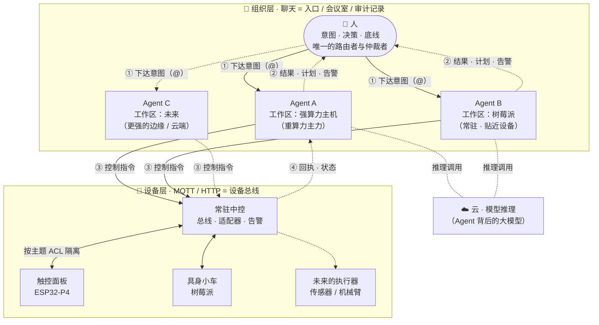
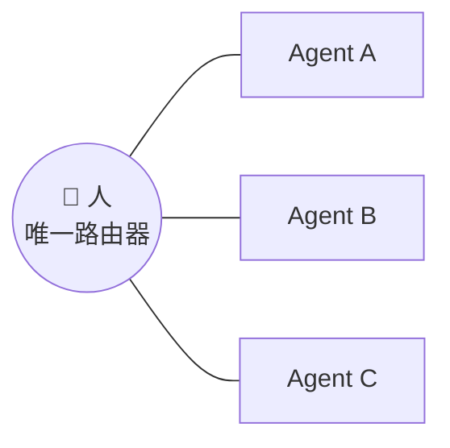

# 全景架构

> 这套系统有两个**互相正交**的切面，看的时候别混：
>
> | 切面 | 回答的问题 | 看到的是 |
> |---|---|---|
> | **纵向 · 算力在哪** | 谁在思考、谁在调度、谁在动 | 云 / 边 / 端 三层 |
> | **横向 · 谁跟谁说话** | 谁能给谁下指令 | 人 ⇄ Agent ⇄ 设备（星形） |
>
> 上一篇 [分布式具身智能](embodied-ai.md) 讲的是纵向；这一篇把两个切面合到一张图上。

---

## 1. 全景

读这张图只需要三句话：

- **纵向：云负责想，边负责调度，端负责动。**
- **横向：人 ⇄ Agent 走聊天，Agent ⇄ 设备走 MQTT / HTTP。两条总线，两个用途。**
- **Agent 之间没有任何一条线 —— 那是设计，不是遗漏**（见 §5）。

---

## 2. Agent 是什么

这是整套架构里最基础、也最容易被搞混的一条：

> **一个 Agent = 一个「工作区 + 记忆 + 大脑」，跑在某台设备上。**

由此推出三条：

| 结论 | 含义 |
|---|---|
| **窗口不是身份** | 群聊 `@`、私聊、直接开终端 —— 都是**同一个 Agent 的不同窗口**，不是不同 Agent |
| **身份由工作区和记忆决定** | 不由"从哪个入口进来"决定，也不由"模型跑在哪"决定 |
| **能力边界 = 设备边界** | 工作区所在的那台机器能做什么，这个 Agent 就能做什么；聊天工具只是入口，不构成边界 |

一个容易混淆的场景：把同一个工作区接进聊天工具，是给这个 Agent **多开了一个窗口**，不是多了一个 Agent。你从手机进来接着干的，还是同一个活。

---

## 3. 组织层：企业微信

它同时承担三个角色：

- **入口** —— 人在哪都能下达意图，不需要公网 IP、不需要专用服务器。
- **会议室** —— 一个群里可以有多个 Agent、一个答疑机器人、一台设备的专属机器人，各应各的 `@`，互不串台。
- **审计记录** —— 谁在什么时候 `@` 了谁、说了什么、回了什么，天然留痕。

> 关键：**这一层是"人 ↔ Agent"的总线，不是"Agent ↔ Agent"的总线。**
> 群里有多个成员，不等于它们之间连了线。

---

## 4. 设备层：MQTT / HTTP

设备用它们**本来就会说**的协议接入：有的走 MQTT 主题，有的就是一个 HTTP 接口。

这一层的职责只有两件：**把指令送下去、把回执带回来。**

中间必须隔一层**设备适配器**，原因有两条：

1. **安全边界** —— 大脑不该直接调 GPIO。适配器是唯一能碰硬件的代码。
2. **异构** —— 每台设备的报文格式、指令集、能力集都不一样。**刻意不做代码层的通用路由**，强做只会得到一堆分支判断。

> 这个"不通用"是**设计选择**，不是没做完。通用的是「怎么管」（主题空间、凭据隔离、适配器形态），
> 不通用的是「怎么接」（每台设备的指令语义）。

**端侧自治**就长在这一层：设备固件不依赖总线存活。总线断了，面板照样能切歌、小车照样能手动遥控。
详见 [分布式具身智能 §二 · 原则三](embodied-ai.md)。

---

## 5. 星形拓扑：为什么 Agent 之间不能直接通信

### 机制：这不是配置，是协议

聊天平台里的 `@` 是**结构化提及实体**，不是正文里的文字。

- Agent 在回复里打一个 `@别人`，那只是普通文本，**不会触发对方**；
- 机器人**只能看到 `@` 自己的那些内容**，不 `@` 就不会触发任何回复。

所以在不额外给 Agent 装"发消息工具"的前提下，**它天然发不出一个能让另一个 Agent 响应的指令** —— 信息也一起被隔离了，不只是"不能主动发"。

### 三个直接后果

1. **人是唯一的路由器。** 任何跨 Agent 的协同，都要经过人。
2. **人也是唯一的共享上下文。** 因为 Agent 之间看不到彼此被 `@` 的内容，跨 Agent 的信息只存在于**人的脑子里和群聊记录里**。
3. **"写计划"与"执行结果"之间，永远隔一个人。** 要让 Agent 自己看到结果，只能走**落盘**。

### 这是代价，不是缺陷

上面第 2、3 条经常被当成"不够智能"。但它是**防串通**的直接价格：

- **防打架** —— 两个 Agent 同时指挥一台设备，指令会互相覆盖。
- **防串通** —— 两个模型互相强化幻觉、互相背书，错的结论会越滚越像真的。
- **可归责** —— 每个动作都能追到"是谁 `@` 的"。

> **如果哪天你想让 Agent 自己派活，那不是"优化掉这个人"，而是换了一套架构** ——
> 那时候防串通、可归责、可观测性，全都要重新回答一遍。

---

## 6. 岗位表：分层怎么落地

组织要分层，但**分层不是写进权限系统里的**。它靠"人给每个 Agent 定位"来成立。

| 组织角色 | 在这个架构里是什么 | 权限 |
|---|---|---|
| **所有者（唯一仲裁者）** | **人** | 唯一决议权、唯一路由权、**唯一 `@` 权** |
| **董事（咨询）** | **不直接参与项目**的 Agent —— 用来脑暴、给更客观的意见 | 只出意见，**无执行权** |
| **CEO / 主力 Agent** | 重算力 Agent，负责**写分工计划** | 出计划，由人分发 |
| **经理 / 员工** | 各个执行型 Agent，每个通常是一个定制的聊天机器人 | 只执行被 `@` 到的指令 |
| **执行器** | 端侧设备（面板 / 小车 / 未来的机械臂） | 由**专属 Agent 代理** |

两点说明：

- **"董事"的意义是视角，不是分权。** 让一个不参与项目的 Agent 来看你的方案，是为了得到更客观的结论 —— 它不干活，也不该有执行权。
- **层级活在人的判断里，不活在 ACL 里。** 所以新增一个 Agent 不需要改权限模型，只需要人判断"它适合接哪类活"。

---

## 7. 三件套在这张图上的位置

| 切面 | 能力 | 由谁实现 |
|---|---|---|
| **控制面** | 人 ⇄ Agent：下达意图、看进度、拦危险动作 | [`Agent-Ops-WeCom-Bridge`](https://github.com/Ly-FirmwareLab/Agent-Ops-WeCom-Bridge) |
| **数据面** | Agent ⇄ 物理世界：设备总线、主题隔离、端侧接入 | [`Agent-Ops-Edge-Hub`](https://github.com/Ly-FirmwareLab/Agent-Ops-Edge-Hub) |
| **总蓝图** | 云 / 边 / 端怎么分层、人站在哪、降级怎么算 | **本仓** |

**控制面与数据面彻底解耦** —— 它们之间不互相调用，只共享同一套约定：

- 同一个 Agent 概念（工作区 + 记忆 + 大脑）
- 同一个路由原则（人 `@` 之后才动）
- 同一条留痕要求（谁点的、跑了什么、结果如何）

**解耦的直接好处**：换掉聊天工具不影响设备层，换掉设备总线不影响控制面。
**代价**：两边要各自维护，且必须靠文档（就是本仓）保持口径一致。

---

## 8. 可扩展性

这套架构的价值，很大一部分在**加东西的成本**上。

| 加什么 | 怎么做 | 成本 |
|---|---|---|
| **一台新设备** | 照现有模板写一个同构适配器，分配主题前缀 + 独立凭据 | 半天量级（已由第 3 类设备实证） |
| **一个新 Agent** | 建新工作区，接一个聊天机器人 | 不需要改权限模型 —— 层级由人的判断决定 |
| **换更大的算力** | 把 Agent 的工作区搬到更强的机器 | ⚠️ 代价明确：**工作区搬走等于换了一个 Agent**，连续性未解决，见 §9 |
| **换一种设备总线** | 只动数据面，控制面不受影响 | 这是解耦设计的直接收益 |
| **主力 Agent 直接派活** | 通过 SSH 连到其它设备，汇总产物 / 直接派活 | **尚未实现**，且必须做成**显式切换的模式**，不能和"人当中介"的常态路线混用 |

---

## 9. 已知边界

写得出来，才说明真的想过。

| 现状 | 说明 |
|---|---|
| **"写计划 → 人分发"仍是手工** | 主力 Agent 能写分工计划，但最终 `@` 谁、说什么，仍由人操作 |
| **跨 Agent 信息必须经人** | 协议隔离的直接代价，不是 bug。想绕过就得改架构（见 §5） |
| **换算力时工作区怎么迁移** | 未决。拷工作区？共享记忆？还是接受"换人接手、重新交代"？ |
| **同一台机器上的多个 Agent 怎么区分** | 机制上可行（不同工作区 + 各自记忆），但还没有长期验证 |
| **主脑失联后的自动接管** | **未实现**。目前是"设备保持本地功能+等人来"，不是"另一个 Agent 自动顶上" |
| **生产级容灾** | 未做。没有冗余、没有 SLA、没有故障演练 |
| **设备动作不可回滚** | 指令重发不会"再执行一次更准"，只会多执行一次。所以必须幂等、有冷却 |

---

上一篇 ← [分布式具身智能](embodied-ai.md)　·　下一篇 → [五条协同约定](conventions.md)