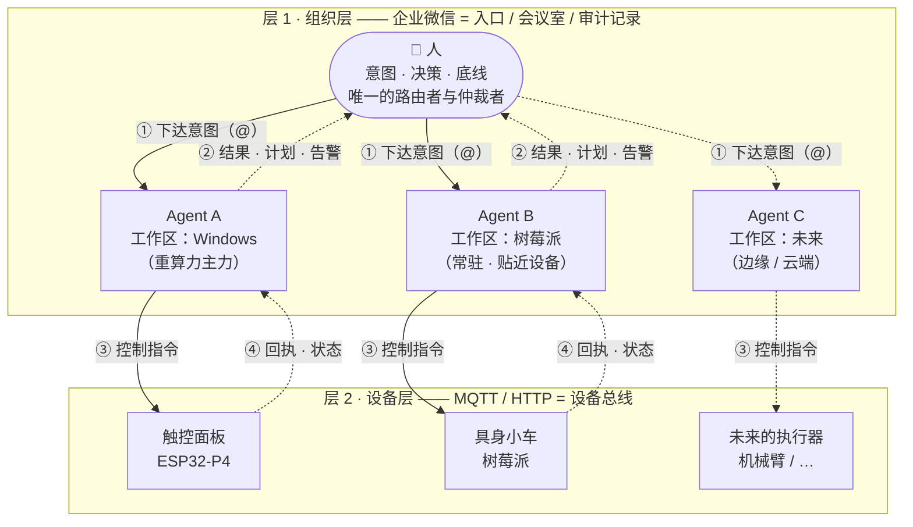
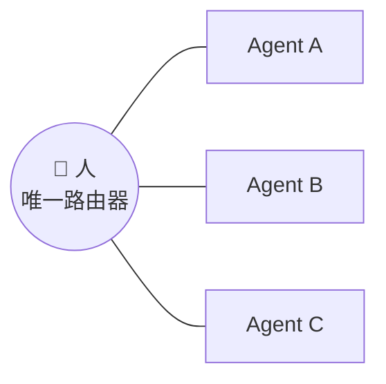

# 全景架构

> 一句话：**一个人，用聊天当入口，指挥多个 Agent；Agent 再去指挥物理设备。**
>
> 下面这张图不是示意图，是这套系统真实的连接关系 —— **注意 Agent 之间没有任何一条线，那是设计，不是遗漏。**

---

## 1. 全景

读这张图只需要三句话：

- **层 1 的总线是聊天**，它的作用是分配**人**的注意力。
- **层 2 的总线是 MQTT / HTTP**，它的作用是分配**机器**的动作。
- **两层之间永远隔着一个 Agent** —— 设备不会直接跟人对话，人也不会直接给设备发指令。

---

## 2. Agent 是什么

这是整套架构里最基础、也最容易被搞混的一条：

> **一个 Agent = 一个「工作区 + 记忆 + 大脑」，跑在某台设备上。**

由此推出三条：

| 结论 | 含义 |
|---|---|
| **窗口不是身份** | 群聊 `@`、私聊、直接开终端 —— 都是**同一个 Agent 的不同窗口**，不是不同 Agent |
| **身份由工作区和记忆决定** | 不由"从哪个入口进来"决定，也不由"模型跑在哪"决定 |
| **能力边界 = 设备边界** | 工作区所在的那台机器能做什么，这个 Agent 就能做什么；聊天工具只是入口，不构成边界 |

一个容易混淆的场景：把同一个工作区接进聊天工具，是给这个 Agent **多开了一个窗口**，不是多了一个 Agent。你从手机进来接着干的，还是同一个活。

---

## 3. 两层结构

### 层 1 · 组织层：企业微信

它同时承担三个角色：

- **入口** —— 人在哪都能下达意图，不需要公网 IP、不需要专用服务器。
- **会议室** —— 一个群里可以有多个 Agent、一个答疑机器人、一台设备的专属机器人，各应各的 `@`，互不串台。
- **审计记录** —— 谁在什么时候 `@` 了谁、说了什么、回了什么，天然留痕。

> 关键：**这一层是"人 ↔ Agent"的总线，不是"Agent ↔ Agent"的总线。**
> 群里有多个成员，不等于它们之间连了线。

### 层 2 · 设备层：MQTT / HTTP

设备用它们**本来就会说**的协议接入：有的走 MQTT 主题，有的就是一个 HTTP 接口。

这一层的职责只有两件：**把指令送下去、把回执带回来。**

每台设备通常配一个**专属 Agent** 代理它 —— 设备的一切上报和下发都经这个 Agent。这样设备本身不需要理解自然语言，也不需要知道"谁在指挥它"。

---

## 4. 岗位表：分层怎么落地

组织要分层，但**分层不是写进权限系统里的**。它靠"人给每个 Agent 定位"来成立。

| 组织角色 | 在这个架构里是什么 | 权限 |
|---|---|---|
| **所有者（唯一仲裁者）** | **人** | 唯一决议权、唯一路由权、**唯一 `@` 权** |
| **董事（咨询）** | **不直接参与项目**的 Agent —— 用来脑暴、给更客观的意见 | 只出意见，**无执行权** |
| **CEO / 主力 Agent** | 重算力 Agent（如 Claude Code），负责**写分工计划** | 出计划，由人分发 |
| **经理 / 员工** | 各个执行型 Agent，每个通常是一个定制的聊天机器人 | 只执行被 `@` 到的指令 |
| **执行器** | 端侧设备（面板 / 小车 / 未来的机械臂） | 由**专属 Agent 代理** |

两点说明：

- **"董事"的意义是视角，不是分权。** 让一个不参与项目的 Agent 来看你的方案，是为了得到更客观的结论 —— 它不干活，也不该有执行权。
- **层级活在人的判断里，不活在 ACL 里。** 所以新增一个 Agent 不需要改权限模型，只需要人判断"它适合接哪类活"。

---

## 5. 星形拓扑：为什么 Agent 之间不能直接通信

### 机制：这不是配置，是协议

聊天平台里的 `@` 是**结构化提及实体**，不是正文里的文字。

- Agent 在回复里打一个 `@别人`，那只是普通文本，**不会触发对方**；
- 机器人**只能看到 `@` 自己的那些内容**，不 `@` 就不会触发任何回复。

所以在不额外给 Agent 装"发消息工具"的前提下，**它天然发不出一个能让另一个 Agent 响应的指令** —— 信息也一起被隔离了，不只是"不能主动发"。

### 三个直接后果

1. **人是唯一的路由器。** 任何跨 Agent 的协同，都要经过人。
2. **人也是唯一的共享上下文。** 因为 Agent 之间看不到彼此被 `@` 的内容，跨 Agent 的信息只存在于**人的脑子里和群聊记录里**。
3. **"CEO 写计划"与"执行结果"之间，永远隔一个人。** 要让 Agent 自己看到结果，只能走**落盘**。

### 这是代价，不是缺陷

上面第 2、3 条经常被当成"不够智能"。但它是**防串通**的直接价格：

- **防打架** —— 两个 Agent 同时指挥一台设备，指令会互相覆盖。
- **防串通** —— 两个模型互相强化幻觉、互相背书，错的结论会越滚越像真的。
- **可归责** —— 每个动作都能追到"是谁 `@` 的"。

> **如果哪天你想让 Agent 自己派活，那不是"优化掉这个人"，而是换了一套架构** ——
> 那时候防串通、可归责、可观测性，全都要重新回答一遍。

---

## 6. 三件套在这张图上的位置

| 层 | 能力 | 由谁实现 |
|---|---|---|
| **组织层** | 人 ⇄ Agent：下达意图、看进度、拦危险动作 | [`Agent-Ops-WeCom-Bridge`](https://github.com/Ly-FirmwareLab/Agent-Ops-WeCom-Bridge)（控制面） |
| **设备层** | Agent ⇄ 物理世界：设备总线、按主题隔离、端侧接入 | [`Agent-Ops-Edge-Hub`](https://github.com/Ly-FirmwareLab/Agent-Ops-Edge-Hub)（数据面） |
| **两层之上** | 为什么这样搭、《协同宣言》、可复用的约定 | **本仓** |

**它们不是三个产品，是同一套架构的三个切面。** 单独用任何一个都能跑，但只有三个一起，才形成"人 → Agent → 物理世界"的完整闭环。

---

## 7. 可扩展性

这套架构的价值，很大一部分在**加东西的成本**上。

**加一台设备**
写一个同构的适配器（照现有模板抄），给它分配一个主题前缀和一套凭据隔离。设备本身不需要理解自然语言。

**加一个 Agent**
建一个新工作区，给它接一个聊天机器人。不需要改权限模型 —— 层级由人的判断决定。

**换更大的算力**
Agent 的工作区可以搬到更强的机器上。代价是明确的：**工作区搬走等于换了一个 Agent**（新工作区、新记忆），如何保持连续性还是一个未决问题，见下一节。

**让主力 Agent 直接派活（尚未实现）**
未来的一条路线是让主力 Agent 通过 SSH 连到其它设备，既能汇总产物，也能直接派活。
**它必须是一个显式切换的模式，不能和"人当中介"的常态路线混用** —— 否则防串通的前提就不成立了。

---

## 8. 已知边界

写得出来，才说明真的想过。

| 现状 | 说明 |
|---|---|
| **"写计划 → 人分发"仍是手工** | 主力 Agent 能写分工计划，但最终 `@` 谁、说什么，仍由人操作 |
| **跨 Agent 信息必须经人** | 协议隔离的直接代价，不是 bug。想绕过就得改架构（见 §5） |
| **换算力时工作区怎么迁移** | 未决。拷工作区？共享记忆？还是接受"换人接手、重新交代"？ |
| **同一台机器上的多个 Agent 怎么区分** | 机制上可行（不同工作区 + 各自记忆），但还没有长期验证 |
| **设备侧的动作是物理的** | 指令重发不会"再执行一次更准"，只会多执行一次。所以必须幂等、有冷却 |

---

上一篇 ← [《协同宣言》](manifesto.md)　·　下一篇 → [五条协同约定](conventions.md)