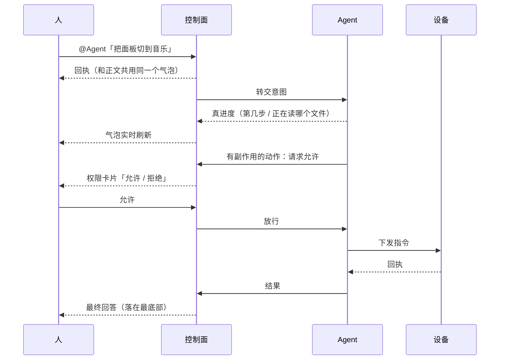

# 五条协同约定

> 这是整套架构里**最不依赖具体实现**的部分。
>
> 换一个聊天工具、换一个 Agent、换一台设备 —— 下面五条照样成立。
> **我们真正想留下的，其实是这一页。**

---

## 约定一 · 入口是聊天

**你在哪，工作台就在哪。**

不需要公网 IP，不需要一台专门的服务器。你已经在用的那个聊天窗口，就是入口。

**为什么**：人不愿意为了"用上 AI"而改变自己的位置。要让 Agent 进入工作流，入口必须是人本来就待着的地方。

**怎么检验**：从"我想让它干一件事"到"它开始干"，中间不该要求你切到另一台电脑、打开另一个终端、或者先连一个 VPN。

---

## 约定二 · `@` 是路由，人是唯一的调度者

**Agent 之间不直接通信。**

**为什么**：防打架、防串通、可归责。

- 两个 Agent 同时指挥一台设备，指令会互相覆盖；
- 两个模型互相强化，错的结论会越滚越像真的；
- 出了问题，要能追到"是谁 `@` 的"。

**怎么检验**：整个系统里，能触发一个 Agent 开始工作的，只有人的 `@`。没有任何自动化路径能替人做"派给谁"的决定。

> 推论：**不提供"一键分发给多个 Agent"这类工具** —— 即使将来有，也必须由人挑目标。
> 便利性不得代替人做决定。

---

## 约定三 · 一个 Agent = 一个工作区 + 一份记忆 + 一个大脑

**换个窗口进来，还是同一个 Agent。**

**为什么**：身份如果由窗口决定，你会得到一个诡异的结果 —— 同一个活，从手机上问和从终端问，得到两个互不相识的助手。

**怎么检验**：在终端里交代的事，从聊天窗口进来还接得上；反之亦然。判断身份看的是**工作区和记忆**，不是"从哪个入口进来的"。

---

## 约定四 · 能力分层，别重复造轮子

**官方已经有的一律用官方，官方没覆盖的才自己补。**

**为什么**：重复实现别人的能力，代价是双份的维护、双份的 bug，而且永远追不上对方。

**怎么检验**：新增一项能力之前，先问一句"官方 / 上游是不是已经有了？"。有条明确的判断法：**如果一个功能你已经写了两遍，第二遍就该考虑接上去而不是再写一遍。**

---

## 约定五 · 每个动作留痕

**谁点的、跑了什么、上下文还剩多少，都看得见。**

**为什么**：AI 执行的速度远快于人的审查速度。留痕不是为了追责，是为了**让"刚才发生了什么"这个问题随时能回答**。

**怎么检验**：出问题时，能不能只靠记录回答这三个问题 —— 谁发起的、执行了什么、结果是什么。答不上来，就是留痕没做到。

---

## 一条任务该长什么样

这是我们对**人机协同交互基准**的具体定义 —— 不只是"能跑通"，而是**每一步都有该有的样子**。

| 环节 | 应有的样子 | 反例 |
|---|---|---|
| **收到** | 先给回执，且和正文**共用同一个气泡** | 另开一条"处理中"，最后又多一条结果 —— 三条消息追着看 |
| **执行** | 显示**真进度**：第几步、正在读哪个文件 | 一个定时器编出来的"已跑 N 秒" |
| **打断** | 任何时候都能停，且停的是**整个进程树** | 停了外壳，子进程还在后台跑 |
| **有副作用** | 危险动作先问「允许 / 拒绝」，**否决权在拦截方自己手里** | 超时或崩溃时默认放行 |
| **收尾** | 结果、拒绝、错误**一律如实回报** | 失败也回"完成" |
| **落位** | 最终回答出现在**最新消息区**，不用往上翻 | 答案被中途发出的卡片顶到上面 |
| **超长** | 才切片，每片**等到回执**再发下一片 | 一口气全推，中间丢掉一片没人知道 |

---

## 设备动作的基线

上面那张表讲的是"人在聊天里发一件事"。**下发到物理设备时，还多四条** ——
因为物理世界的动作**不可回滚**，重发一次不会"更准"，只会多执行一次。

| 要求 | 为什么 |
|---|---|
| **幂等** | 同一条指令重复到达，只执行一次。网络重试是常态，设备不该跟着抖两次 |
| **冷却** | 短时间内同一动作不允许连发，否则会打满设备的重绘/驱动 |
| **回执** | 下发必须能拿到"成没成"。拿不到就如实报警，不能默认成功 |
| **降级** | 总线断了，设备要能自己做完本来就会的事，而不是等总线恢复才恢复 |

---

## 怎么检验你抄对了

照着这六条自测，全部通过基本就是对的：

- [ ] 从手机就能下达任务，不需要打开电脑上的终端
- [ ] 任务执行期间，能看到它**正在做什么**，而不只是"处理中"
- [ ] 随时能喊停，且停完之后**没有残留进程**
- [ ] 有副作用的动作会先问你；超时**默认拒绝**，不是默认放行
- [ ] 失败会如实告诉你失败，不会包装成"完成"
- [ ] 事后能查到：谁发起的、跑了什么、结果如何
- [ ] **拔掉网线**，设备还能做完它本来就会的那几件事

---

上一篇 ← [全景架构](architecture.md)　·　回到 [首页](../README.md)