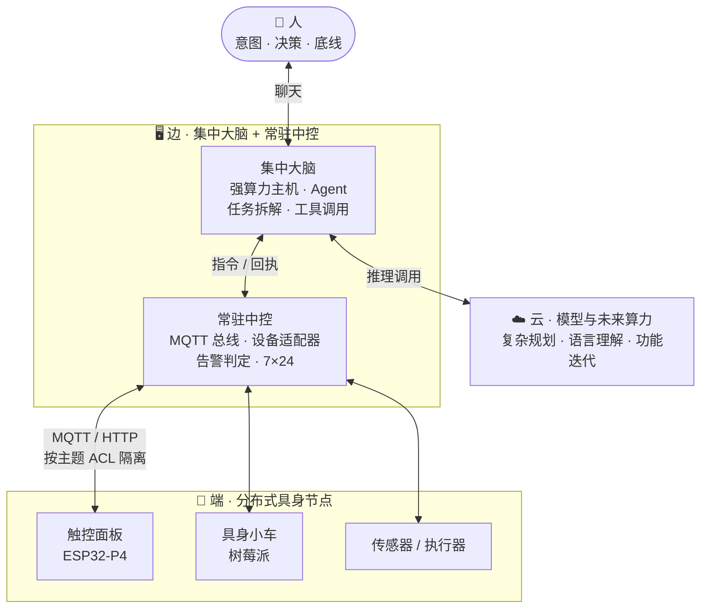

# 分布式具身智能

> **Distributed Embodied AI**
>
> 这一篇是整套架构的**顶层设计**：当 AI 开始需要一具身体，这具身体该怎么接？
>
> 我们的答案不是"把模型塞进设备"，而是**把大脑和躯体拆开**。

---

## 一 · 今天的问题：AI 被困在数字世界里

大模型的输出是 token，不是动作。它能把一份合同改到无可挑剔，却端不起一杯水。

现在有两种"让 AI 进入物理世界"的做法，都不够用：

| 做法 | 问题 |
|---|---|
| **把模型塞进设备** | 算力不够、迭代跟不上、断网就发呆；每台设备都要重新适配一次 |
| **做云端 API 让设备来调** | 设备退化成"联网开关"：没有本地判断力，网络一断就是块砖 |

两者共享同一个错误假设：**智能和身体必须是同一个东西。**

真正的第三种做法，是把它们**解耦** —— 想事的专心想事，动手的专心动手，中间用一条**窄而确定的通道**连起来。

---

## 二 · 三条设计原则

### 原则一 · 大脑集中，躯体分布

- **大脑**：一台常开的强算力主机，跑 Agent —— 任务拆解、工具调用、模型推理。
- **躯体**：触控面板、小车、传感器……每一个都是**独立的物理节点**。
- **关键**：躯体不是"远程屏幕"。它自己有一小撮本地判断力，那是它活着的凭据。

为什么大脑要集中？因为**算力是稀缺的，而设备是廉价的**。让 20 台设备各装一份推理栈，不如让一台机器想清楚，再分发下去。

### 原则二 · 通道窄，契约硬

大脑不直接调 GPIO。中间必须隔一层**设备适配器**：

- 报文有大小上限（超了降级，不静默丢弃）
- 指令幂等（重复下发只执行一次）
- 回执有超时（超时如实报错，不假装成功）
- 动作有冷却（防连点打满设备）

这些不是洁癖。**物理世界的动作不可回滚** —— 重发一次不会"更准"，只会多执行一次。

### 原则三 · 优雅降级，边缘自治（本架构的核心底线）

> **主服务器宕机、网络中断时，系统的表现应该是"能力退化"，而不是"全面瘫痪"。**

从**全局智能**降级为**局部自治**：

| 断掉什么 | 还剩什么 |
|---|---|
| 模型不可用 | 已下发的动作照常执行；设备本地功能全在 |
| 大脑主机下线 | 远程指挥中断；设备仍能靠自己的固件完成基本交互 |
| 局域网中断 | 单机功能照旧 —— 切歌、看相册、调亮度、手动遥控、避障 |

**验收判据只有一句：拔掉网线，设备还能做完它本来就会的那几件事吗？**

这一条是架构的**验收标准**，不是加分项。因为在物理世界里，**连续性比智能更重要** ——
一个不会避障的"智能小车"，不如一个能停下来的笨小车。

---

## 三 · 端 · 边 · 云

**为什么「边」这一层在我们这里是两台机器？**

因为**大脑会重启、会升级、会换机器；中控要 7×24 常开**。
把它们合在一台上，等于让"换大脑"变成"停设备" ——
而这恰好违反了原则三。

---

## 四 · 这条通道长什么样

不在于用什么协议，在于它必须满足的四条：

| 要求 | 为什么 |
|---|---|
| **双向** | 只下发不回执 = 不知道动作成没成。回执必须是通道的一部分，不是可选项 |
| **隔离** | 每台设备只能看见自己的主题。一台设备被攻破，爆炸半径不扩散 |
| **可鉴权** | 设备身份要能验证（证书 / 凭据），而不是"在同一个局域网里就信你" |
| **可降级** | 通道断了，设备要能自己活着，而不是等通道恢复才恢复 |

MQTT 不是唯一答案，但它同时满足这四条，而且足够轻 —— MCU 上有成熟的客户端库。

---

## 五 · 我们做到哪一步

这是"实证托底"的那一半。**主张说得多硬，这里就要写得多具体。**

| 主张 | 目前的实证 |
|---|---|
| 大脑与躯体解耦 | ✅ 已跑通：面板与小车的动作由 Agent 经 MQTT 下发，双向回执 |
| 通道契约化 | ✅ 已实现：帧大小上限、QoS 1 全链路、指令幂等去重、动作冷却、并发闸、超时如实报错 |
| 设备隔离 | ✅ 已实现：双向证书 + 按主题收窄的 ACL + 每设备独立凭据 |
| 边缘自治 | 🟡 **部分**：端侧固件与本地入口独立于总线存活，断网不瘫痪；但**尚无**"主脑失联后自动接管任务"的编排 |
| 异构设备同构接入 | ✅ 第 3 类设备（小车）照已有模板接入，半天完成 |
| 生产级容灾 | ❌ **未做**：没有冗余、没有 SLA、没有故障演练 |

最后一行必须写。**我们给的是架构判断，不是可用的产品级保障。**

---

## 六 · 这不是产品，是一份样板

我们的测试床很小：几台异构边缘终端（覆盖 HTTP 与 MQTT）、若干主流 Agent 框架，以及一个局域网络。
但它把这条路径上**绕不开的问题**都摆到了台面上，并给出了在工程上站得住脚的答案：

- **躯体怎么接？** —— 不塞模型，隔一层适配器。
- **断网怎么办？** —— 降级，不是瘫痪。
- **人站在哪？** —— 在中间，而且是唯一的路由器。
- **出了问题谁负责？** —— 追得到具体的一次 `@`。

我们真正想留下的不是这套代码，而是**这几个问题的答案**。

代码会过时，问题不会。

---

上一篇 ← [《协同宣言》](manifesto.md)　·　下一篇 → [全景架构](architecture.md)